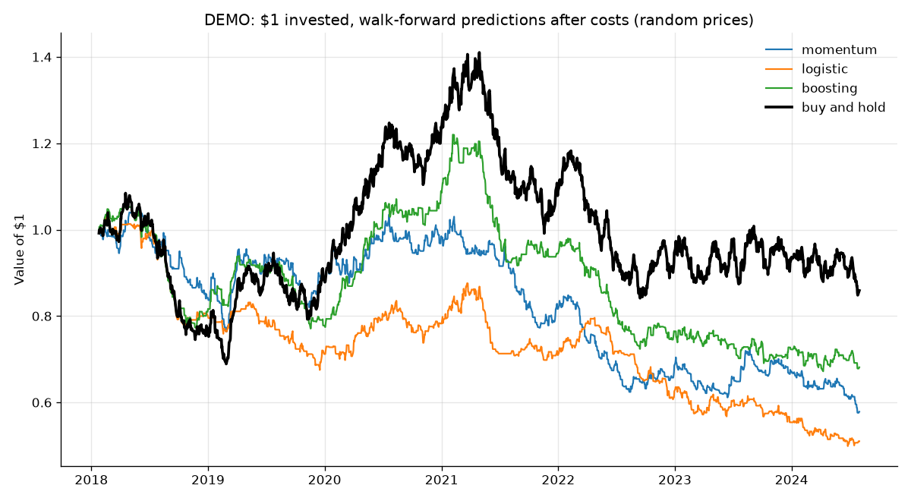

# alpaca-predictor

[](https://github.com/DarcyMF/alpaca-predictor/actions/workflows/ci.yml)

Can a machine learning model predict whether a stock will close higher tomorrow? This project pulls daily prices from [Alpaca](https://alpaca.markets), trains models on technical indicators, and tests them honestly: walk-forward training, trading costs, and simple baselines they have to beat. It can also turn the latest prediction into a trade on an Alpaca **paper** account (fake money).

> This is a learning project, not financial advice. It only connects to Alpaca's paper trading account and can't place real trades.

## What it does

1. **Downloads daily bars** (open, high, low, close, volume) from Alpaca, adjusted for splits and dividends, and saves them to `data/`.
2. **Builds 13 features** for each day using only prices up to that day: returns over 1 to 20 days, volatility, distance from the 10 and 50-day averages, RSI, MACD, volume compared to normal, the day's range, and day of the week.
3. **Trains models walk-forward.** It trains on the first three years, predicts the next month, adds that month to the training data, retrains, and repeats. A model never sees a day before predicting it.
4. **Backtests the rule** "hold the stock tomorrow if the model says up is more likely, otherwise hold cash", paying 0.05% every time it buys or sells.
5. **Compares against baselines.** Buy and hold, and "momentum" (tomorrow goes the same way as today). A model that can't beat these isn't worth anything.

Models: logistic regression and gradient boosting (scikit-learn).

## Sanity check on random prices

Before trusting any result, I run the whole thing on made-up prices that follow a random walk. Nothing can predict a random walk, so every model should land around 50% accuracy and lose money to trading costs. If one made money here, it would mean the backtest was leaking future data somewhere.

```
python -m predictor backtest --demo
```



| strategy     | accuracy | total return | per year | sharpe | max drawdown | time in market | trades |
|:-------------|---------:|-------------:|---------:|-------:|-------------:|---------------:|-------:|
| momentum     |     49.5 |        -42.1 |     -7.8 |  -0.58 |        -44.9 |           49.1 |    859 |
| logistic     |     48.1 |        -49.0 |     -9.5 |  -0.78 |        -51.7 |           44.1 |    652 |
| boosting     |     50.4 |        -31.9 |     -5.5 |  -0.40 |        -44.9 |           45.8 |    741 |
| buy_and_hold |     49.1 |        -14.1 |     -2.2 |  -0.04 |        -40.3 |          100.0 |      1 |

All about 50%, all worse than just holding. That's the right answer. The same model does find a pattern when one really exists (see `test_model_learns_a_real_pattern`), so it's not just broken.

## Results on real data

Run `python -m predictor backtest SPY` with your keys set up and it saves `reports/spy.png` and `reports/spy.md`.

## Setup

You need Python 3.11+ and a free Alpaca account.

```bash
python3 -m venv .venv
source .venv/bin/activate
pip install -r requirements.txt
cp .env.example .env
```

Put your **paper trading** API keys in `.env` (Alpaca dashboard > Paper Trading > API Keys).

## Commands

```bash
python -m predictor backtest SPY              # backtest one symbol, chart in reports/
python -m predictor backtest QQQ --cost 10    # try a higher trading cost
python -m predictor backtest --demo           # random prices, no keys needed
python -m predictor signal SPY                # today's prediction and what it would do
python -m predictor signal SPY --submit       # send that order to the paper account
```

`signal` is a dry run unless you add `--submit`. Run it after the market closes; the order fills at the next open.

## How it's built

```
predictor/
  data.py       Alpaca download, CSV cache, random-walk prices for testing
  features.py   features and the next-day target
  model.py      walk-forward training, baselines
  backtest.py   trading rule, costs, return, Sharpe ratio, drawdown
  report.py     chart and results table
  trade.py      turns a prediction into a paper order
tests/          22 pytest tests
```

### Things I had to get right

- **No look-ahead.** Every feature uses a trailing window. There's a test that changes all prices after a certain day and checks that no earlier features change.
- **No training on the test days.** Another test records what each model was trained on and checks it all comes before the days it predicts.
- **Costs.** Without them, a strategy that trades every day can look good on noise.
- **Accuracy alone is misleading.** Stocks go up a bit more than half the time, so "always up" already gets better than 50%. That's why buy and hold is in every table.
- **Paper only.** `TradingClient(..., paper=True)` is hard coded, and a test checks it.

## Ideas for later

- Walk-forward tuning of the threshold instead of a fixed 0.5
- Try more symbols at once and see if anything holds up across all of them
- Add features from other markets (VIX, bond yields)
